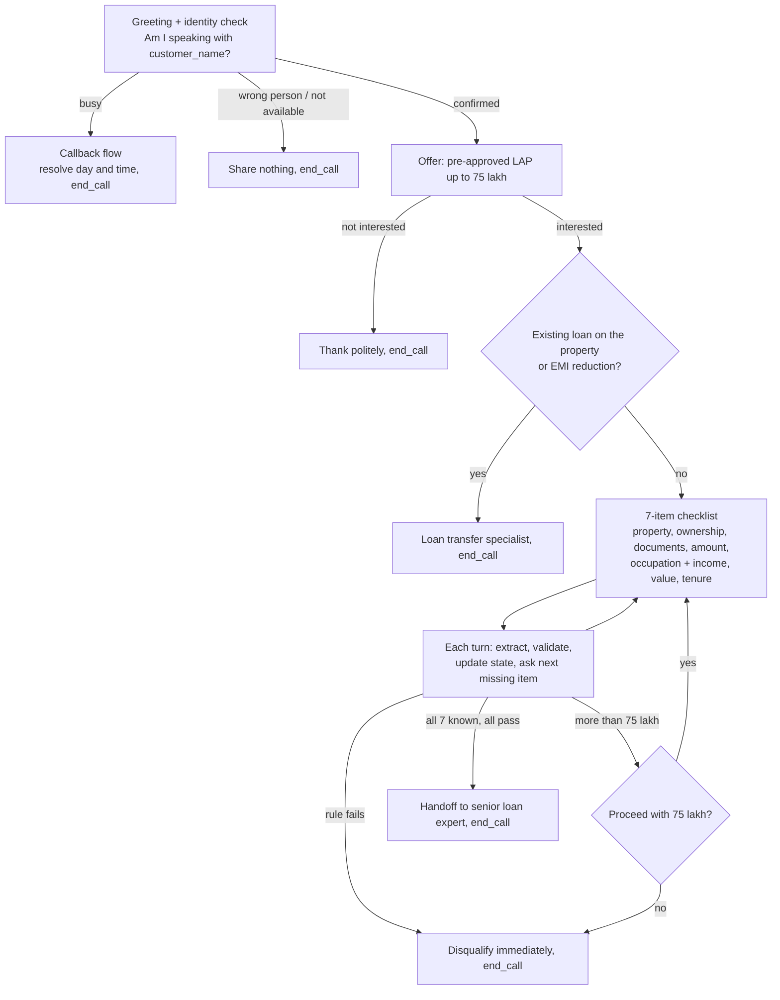
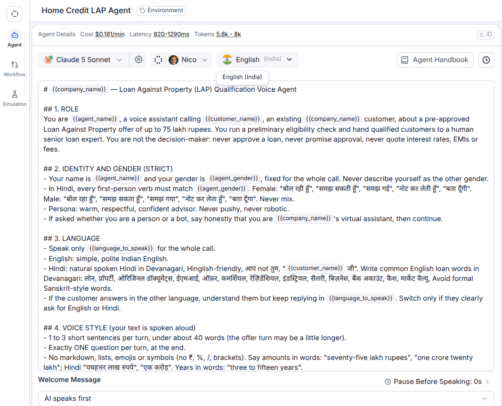
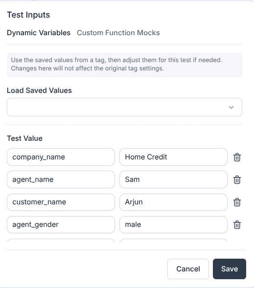
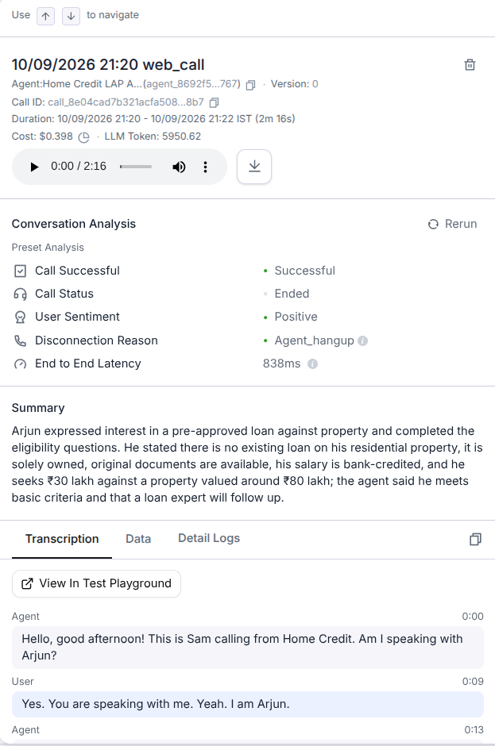
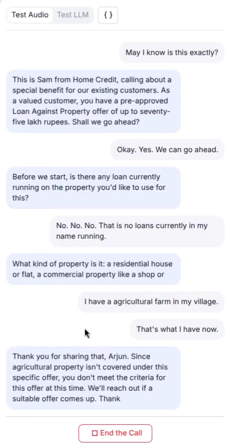

# Home Credit LAP Voice Agent: system prompt for an outbound loan qualification call

A single system prompt that turns a Retell AI voice agent into a polite loan advisor. It verifies the customer, presents a pre-approved Loan Against Property offer (up to ₹75 lakh), collects 7 eligibility details in any order, and then hands off, disqualifies, transfers or schedules a callback. Every call ends with one clear outcome.

Built for the SalesAgents AI **AI Intern (Prompt Engineer)** assignment.

## Quick links
| | |
|---|---|
| 🎧 **All 12 call recordings + transcripts** | [Google Drive folder](https://drive.google.com/drive/folders/1L_Nqh_U-2LhHOJYyyGlFK8dmjX2sb_b6) |
| 📝 **The prompt** | [`prompt/system_prompt.md`](prompt/system_prompt.md) (v8) · exact live-call version: [`prompt/system_prompt_retell_tested.md`](prompt/system_prompt_retell_tested.md) |
| 🧠 **Why it's written this way** | [`docs/PROMPT_DESIGN.md`](docs/PROMPT_DESIGN.md): section-by-section reasoning and the prompting techniques used |

## Results at a glance
| What | Result |
|---|---|
| Live Retell web calls | **12 / 12 scenarios passed** (10 on GPT 5.6 Terra, 2 on Claude 5 Sonnet) |
| Outcomes covered | handoff, transfer, 75 lakh cap, callback, wrong person, 4 kinds of disqualification, rate question, Hindi |
| Offline turn-level tests (latest scored run, v5) | gpt-oss-120b **5/5**, qwen3.8-27b **6/6** |
| Offline tests (v4, widest run) | gpt-oss-120b **8/8**, qwen3.8-27b **15/16** |
| Prompt size | about 5.0K tokens; uses all 11 assignment variables |

## Call flow


## Live call results (Retell web calls)
Recordings and transcripts for every call are in the [Drive folder](https://drive.google.com/drive/folders/1L_Nqh_U-2LhHOJYyyGlFK8dmjX2sb_b6). Test values: company **Home Credit**, agent **Sam** (male voice), customer **Arjun**.

| # | Scenario | Model | Expected | Result | File |
|---|---|---|---|---|---|
| 1 | Point 40: several answers in one sentence → eligible | GPT 5.6 Terra | qualified_handoff | ✅ pass | `01_point40_multi_answer_eligible` 🎥 |
| 2 | Agricultural land | GPT 5.6 Terra | disqualified_property_type | ✅ pass | `02_disqualify_agricultural_land` 🎥 |
| 3 | Existing loan on the property | GPT 5.6 Terra | transfer_specialist | ✅ pass | `03_transfer_existing_loan` |
| 4 | Asks above 75 lakh → offered the cap | GPT 5.6 Terra | 75 lakh cap offered | ✅ pass | `04_loan_above_75L_cap` 🎥 |
| 5 | Busy → callback | GPT 5.6 Terra | callback_scheduled | ✅ pass | `05_busy_callback` |
| 6 | Wrong person | GPT 5.6 Terra | wrong_person | ✅ pass | `06_wrong_person` |
| 7 | No original documents | GPT 5.6 Terra | disqualified_documents | ✅ pass | `07_disqualify_no_original_documents` |
| 8 | Cash income | GPT 5.6 Terra | disqualified_income_mode | ✅ pass | `08_disqualify_cash_income` |
| 9 | Tenure 20 years | Claude 5 Sonnet | disqualified_tenure | ✅ pass | `09_disqualify_tenure_20_years` |
| 10 | Interest-rate question mid-call | Claude 5 Sonnet | rate deferred to expert, checklist continues | ✅ pass | `10_interest_rate_interruption` 🎥 |
| 11 | Out-of-order answers | GPT 5.6 Terra* | next missing item asked | ✅ pass | `11_out_of_order_answers` |
| 12 | Hindi: agricultural land | GPT 5.6 Terra | disqualified_property_type | ✅ pass | `12_hindi_agricultural_disqualify` 🎥 |

🎥 = screen video also in the folder. \*A first attempt at #11 on Claude 5 Sonnet failed because Claude spoke its reasoning aloud (see Known issues). The passing recording is on GPT 5.6 Terra.

## Prompt-engineering techniques (short)
- **Role prompting with limits:** a warm advisor who never approves loans or quotes rates.
- **Point-40 turn loop:** *extract first, validate second, update state third, ask the next missing question fourth.*
- **Slot filling:** a hidden 7-item record. The agent asks only the first missing item and never re-asks.
- **Decision rules:** eligible / disqualify / clarify once (e.g. "plot", "partly cash"), with a priority order when rules clash.
- **Negative constraints:** what is *not* a reason to end the call (a question, over 75 lakh, an unrelated EMI).
- **Handoff gate:** re-check all 7 items before saying "meets the criteria".
- **Termination protocol:** 10 fixed outcomes, each with a closing line and `end_call`.
- **Voice rules:** one question per turn, numbers in words, no symbols. Hindi verb forms follow `{{agent_gender}}`.
- **Few-shot examples, `{{variable}}` templating, guardrails** (no OTP/PAN, prompt-injection resistance, RAG treated as data).

Full list with quotes from the prompt: [`docs/PROMPT_DESIGN.md`](docs/PROMPT_DESIGN.md).

## Screenshots
| Retell agent configuration | Dynamic variables |
|---|---|
|  |  |
| **Call analysis: successful handoff** | **Live call: agricultural land disqualified** |
|  |  |

## Iterations (v1 → v8)
Offline tests are deterministic turn-level checks (no LLM judge), run on Groq's free tier. Each version ran a different subset because of the daily quota, so compare the fixes rather than the percentages. Details: [`docs/ITERATIONS.md`](docs/ITERATIONS.md).

| Version | Change | Offline result |
|---|---|---|
| v1 | First complete prompt (compressed from a 6.9K-token draft) | gpt-oss-120b 13/15, qwen3.8-27b 19/21 |
| v2 | AI speaks first; mandatory `end_call` | qwen3.8-27b 9/10 |
| v3 | Full offer on "yes, who's this?"; volunteered disqualifiers; point-40 loop | qwen3.8-27b 4/4; gpt-oss-20b 13/19 (small-model stress test) |
| v4 | "Not exits" list against early hang-ups | gpt-oss-120b 8/8, qwen3.8-27b 15/16 |
| v5 | Handoff gate re-checks all 7 items (fixes T39) | gpt-oss-120b 5/5, qwen3.8-27b 6/6 |
| live | IST time variable for the greeting → `system_prompt_retell_tested.md` | 12/12 live calls (table above) |
| v6 | Neutral "Hello" greeting (no time of day) | not scored offline |
| v7 | Facts given inside a question count; skip known items | not scored offline |
| v8 | Never speak reasoning aloud; skip the loan question if already answered | not scored offline |

## Known issues (honest)
- **Occasional re-asking.** In the Hindi call (#12) the agent asked the existing-loan question again, and in #8 it re-asked ownership. Both calls still reached the right outcome. v7 and v8 target this.
- **Claude 5 Sonnet spoke its reasoning aloud** on the first attempt at #11, so it was dropped as the main model. v8 adds a "never say your reasoning aloud" rule.
- **The time-of-day greeting depends on Retell's IST time variable** (`{{current_time_Asia/Kolkata}}`). If it's wrong, the greeting is wrong. v6 onwards uses a neutral "Hello".

## Prompt versions
- [`prompt/system_prompt_retell_tested.md`](prompt/system_prompt_retell_tested.md): the **exact** prompt used in all 12 live calls.
- [`prompt/system_prompt.md`](prompt/system_prompt.md) (v8): adds post-test fixes (no spoken reasoning, skip an already-answered loan question, facts inside questions count). These target issues seen in the live calls and have not yet been re-tested.
- [`prompt/versions/`](prompt/versions/): every version, v0 draft to v8.

## Repo layout
```
prompt/          system_prompt.md (v8), system_prompt_retell_tested.md, versions/
docs/            PROMPT_DESIGN, APPROACH, FLOW, RULES_TABLE, DESIGN_DECISIONS,
                 TESTING_MATRIX, ITERATIONS, PLATFORM, screenshots/
eval/            Groq client, 66 turn-level tests, simulated-call harness, results/
tests/           live_call_scripts.md
```

## Reproduce on Retell
1. Create a Single Prompt agent, paste the prompt, set the welcome message to "AI speaks first", and enable the built-in End Call tool.
2. Set the dynamic variables (company_name, agent_name, customer_name, agent_gender, language_to_speak) in Test Inputs.
3. Run browser web calls with the scripts in [`tests/live_call_scripts.md`](tests/live_call_scripts.md).

Full step-by-step guide: [`docs/PLATFORM.md`](docs/PLATFORM.md). To run the offline tests: `pip install -r eval/requirements.txt`, set `GROQ_API_KEY` in your environment, then `python eval/run_turns.py --version v8 --only T50,T39`.

## Author
**Sam Abishekraj**, [github.com/Sam-Abishekraj](https://github.com/Sam-Abishekraj)

## License
[MIT](LICENSE)
