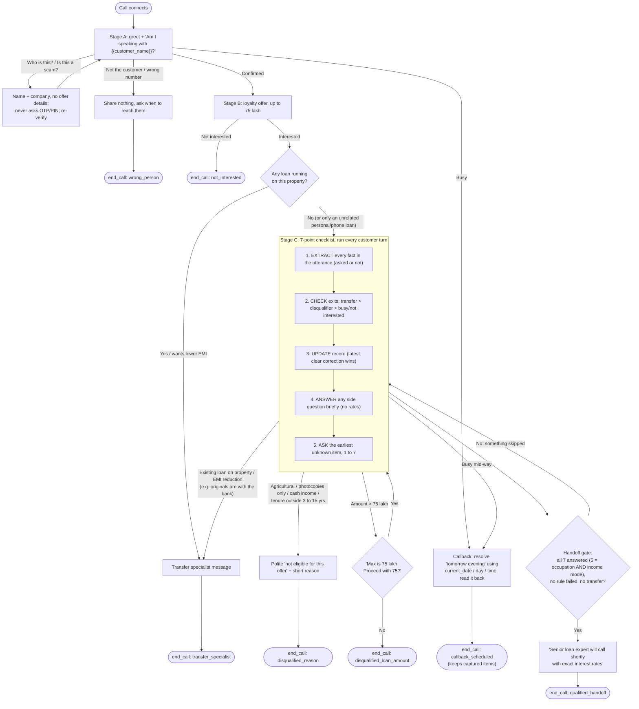

# Call flow

The diagram is the state machine that `prompt/system_prompt.md` implements in natural language.
Exits on the right (busy, transfer, disqualification) can fire at any stage, not only where they are drawn.



## Per-turn algorithm (Section 5 of the prompt)

```
on customer utterance:
    facts   = extract_all(utterance)              # property, ownership, docs, amount, occupation, income, value, tenure, loans
    if transfer_trigger(facts):   say(transfer_script);  end_call("transfer_specialist")
    elif disqualifier(facts):     say(disqualify_script); end_call("disqualified_<reason>")
    elif busy / not interested / wrong person: handle exit
    record.update(facts)                           # a clear later correction overwrites
    answer_side_question_if_any()                  # never quote rates; RAG only for product facts
    if amount > 75 lakh and cap not answered: ask_cap()
    elif all_7_answered(record): handoff()         # gate
    else: ask(first_unknown_item(record))          # never re-ask a known item
```
